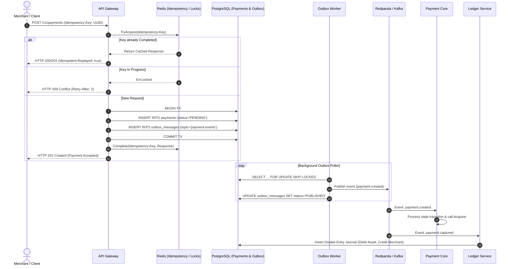

# Архитектура платежного процессинга (Fault-Tolerant Payment Processing)

## 1. Ключевые принципы надежности (Mission-Critical Fintech)

1. **Гарантированная идемпотентность (Idempotency)**:
   - Клиент отправляет заголовок `Idempotency-Key` (UUIDv4/UUIDv7).
   - Распределенная блокировка в Redis атомарно захватывает ключ (`SETNX` с TTL).
   - Если запрос дублируется в момент выполнения: возвращается HTTP 409 Conflict.
   - Если транзакция уже завершена: возвращается сохраненный ответ из кэша с заголовком `Idempotent-Replayed: true`.
   - Деньги клиента никогда не списываются дважды.

2. **Паттерн Transactional Outbox (Исключение Dual-Write)**:
   - Сохранение состояния платежа и создание события для брокера (Kafka) выполняются в **одной ACID-транзакции** базы данных PostgreSQL.
   - Фоновый воркер (`outbox-worker`) вычитывает события пачками с использованием `SELECT ... FOR UPDATE SKIP LOCKED`.
   - Это гарантирует горизонтальное масштабирование воркеров без взаимных блокировок и потерь сообщений (At-Least-Once delivery).

3. **Двойная запись (Double-Entry Ledger)**:
   - Балансы не изменяются прямым `UPDATE balance = balance + 100`.
   - Каждая транзакция состоит минимум из двух проводок (Дебет и Кредит), сумма которых строго равна 0.
   - Неизменяемый аудит-лог (Immutable Audit Trail).

4. **Отказоустойчивость внешних вызовов (Resilience)**:
   - **Circuit Breaker**: автоматическое размыкание цепи при деградации внешнего банка/провайдера (Stripe, Adyen, СБП).
   - **Exponential Backoff с Full Jitter**: предотвращение "thundering herd" при сетевых сбоях.

5. **Безопасность данных (PCI-DSS Ready)**:
   - Автоматическое маскирование номеров карт (PAN: первые 6 и последние 4 цифры) и CVV в структурированных логах.
   - Использование `Money` с целыми числами (minor units/копейки/центы), исключающее ошибки округления с плавающей точкой (float).

---

## 2. Схема архитектуры



---

## 3. Структура проекта (Go Monorepo)

```
payment-gate/
├── cmd/                          # Точки входа микросервисов
│   ├── api-gateway/              # Входной HTTP/gRPC шлюз с идемпотентностью
│   ├── payment-core/             # Ядро процессинга (оркестрация и state machine)
│   ├── outbox-worker/            # Фоновый воркер Transactional Outbox
│   └── ledger/                   # Сервис двойной бухгалтерской записи
├── pkg/                          # Базовые переиспользуемые модули (оснастка)
│   ├── idempotency/              # Distributed lock + cache (Redis/Memory)
│   ├── outbox/                   # Transactional outbox (SQL, worker, retry)
│   ├── resilience/               # Circuit breaker, retry с jitter
│   ├── money/                    # Безопасная работа с валютой (без float)
│   ├── logger/                   # slog с маскированием PAN/CVV и контекстом
│   ├── postgres/                 # pgxpool менеджер транзакций и healthcheck
│   └── shutdown/                 # Graceful shutdown координатор
├── migrations/                   # SQL миграции PostgreSQL
│   ├── 000001_init_schema.up.sql
│   └── 000001_init_schema.down.sql
├── deployments/                  # Локальное окружение и оркестрация
│   └── docker-compose.yml        # Postgres, Redis, Redpanda, Jaeger, Prometheus
├── docs/                         # Архитектурная документация
├── .golangci.yml                 # Строгие правила линтера для финтеха
├── Makefile                      # Скрипты сборки и управления
├── Taskfile.yml                  # Кросс-платформенные задачи (Windows/Linux)
└── go.mod                        # Go зависимости
```
